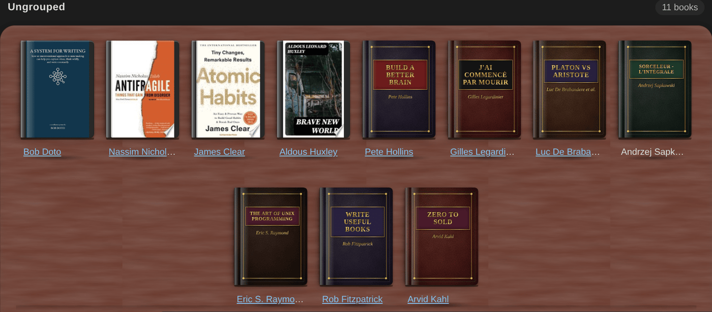
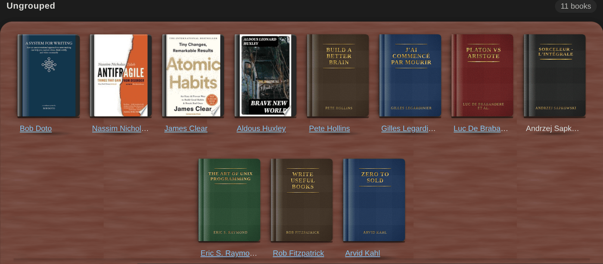
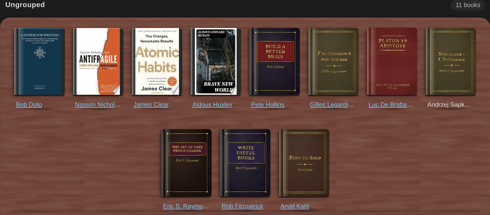
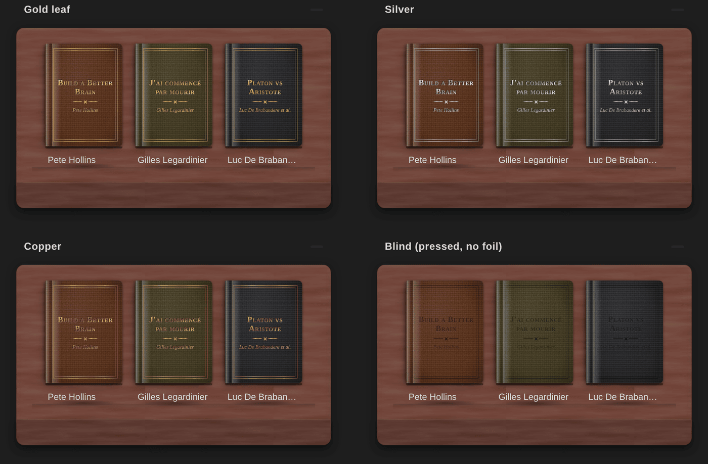

# Configuration

All configuration happens in the **view options panel** of the Base view. Open the view's settings (gear icon) after selecting the **Bookshelf** view type.

## View options

### Layout

| Setting           | Type   | Default | Description                                                   |
| ----------------- | ------ | ------- | ------------------------------------------------------------- |
| Card size         | Slider | `150`   | Width of each book in pixels. Range: 50–800, step 10.         |
| Gap between books | Slider | `20`    | Horizontal gap between books in pixels. Range: 20–60, step 4. |

Book height is computed from `cardSize / aspectRatio` (see Cover section below).

### Shelf material

| Setting        | Type     | Default | Description                                           |
| -------------- | -------- | ------- | ----------------------------------------------------- |
| Shelf material | Dropdown | `Oak`   | Visual texture applied to the shelf behind the books. |

Available textures:

- **Woods**: Oak, Walnut, Cherry, Mahogany, Pine, Ebony
- **Metal**: Brushed Metal, Dark Metal
- **Stone**: White Marble, Black Marble, Concrete, Slate

### Decorations

| Setting           | Type   | Default | Description                                                                                       |
| ----------------- | ------ | ------- | ------------------------------------------------------------------------------------------------- |
| Shelf decorations | Toggle | `On`    | When off, the shelf is drawn as a flat surface with no wood/stone texture, ledge, or drop shadow. |
| Book shadows      | Toggle | `On`    | When off, books lose their grounding shadow and 3D hardcover shading for a flatter, minimal look. |

Turn both off for a clean, decoration-free bookshelf.

### Cover

| Setting             | Type     | Default           | Description                                                                                                                                                                                                                                                                                                            |
| ------------------- | -------- | ----------------- | ---------------------------------------------------------------------------------------------------------------------------------------------------------------------------------------------------------------------------------------------------------------------------------------------------------------------- |
| Image property      | Property | _(none)_          | The property containing the cover image (URL, `data:` URI, vault-relative path, bare file name, wikilink such as `[[cover.jpg]]`, or markdown image). File names and wikilinks resolve like links. Falls back to `note.cover` if unset. A missing vault file, or an image that does not load, shows the default cover. |
| Image fit           | Dropdown | `Contain`         | How cover images fit the book shape. `Contain` preserves aspect ratio; `Cover` crops to fill.                                                                                                                                                                                                                          |
| Cover without image | Dropdown | `Cloth hardcover` | What a book looks like when it has no usable cover image: `Cloth hardcover`, `Leather with label`, `Library binding`, `Mixed (cloth, leather, library)` or `Classic spine`. See [Default covers](#default-covers).                                                                                                     |
| Author property     | Property | _(none)_          | The property that holds the author, lettered on default covers. If unset, the view tries `author`, then `authors`.                                                                                                                                                                                                     |
| Cover lettering     | Dropdown | `Gold leaf`       | The foil used for the title and the author on default covers: `Gold leaf`, `Silver`, `Copper` or `Blind (pressed, no foil)`.                                                                                                                                                                                           |
| Aspect ratio        | Slider   | `0.67`            | Width ÷ height of a book: `cardSize ÷ aspectRatio` gives the book height. Range: 0.25–2.5, step 0.01. A missing or invalid value gives `0.67`; a value outside the range is clamped to the nearest limit.                                                                                                              |

Typical aspect ratios:

- `0.67` — 2:3, the shape of most printed books (default)
- `0.71` — A-series paper and European book formats
- `1` — square, e.g. albums
- `1.5` — landscape
- `0.25` — spines: any ratio of 0.4 or less turns default covers into book spines

Views that never set **Aspect ratio** were square (`1`) in earlier versions. They now show taller 2:3 books. To get the square look back, set **Aspect ratio** to `1`.

### Default covers

A book without a cover image gets a hardcover drawn by the plugin, with its title (and its author) lettered in gold leaf. It's pure CSS: no image file, nothing to download. The same thing happens when the image can't be loaded (a missing vault file, a 404, a dead host, no network).

The color comes from the title. So does the binding when you use **Mixed**. A book keeps the same look in every view and after every reload. The colors are dark bookcloth and leather tones, so the lettering stays readable.

Pick the binding in **Cover without image**:

| Option                          | What you get                                                                                                                                  |
| ------------------------------- | --------------------------------------------------------------------------------------------------------------------------------------------- |
| Cloth hardcover (default)       | Linen texture, a double gold frame, the title in small caps with a small ornament, the author in italics.                                     |
| Leather with label              | Grained leather, a gold frame with dots in the corners, the title on a dark label.                                                            |
| Library binding                 | Plain library cloth, the title in capitals between two gold rules at the top, the author at the foot. The easiest one to read on small cards. |
| Mixed (cloth, leather, library) | Each book gets cloth, leather or library binding, picked from its title. Your shelf looks like an old library.                                |
| Classic spine                   | The look of earlier versions: a colored block with the title in white, running vertically. Pick this one to turn default covers off.          |

**Cover lettering** changes the foil: **Gold leaf** (default), **Silver**, **Copper**, or **Blind**, where the letters are pressed into the cover with no foil at all. Blind is the most discreet option, and also the hardest to read, so keep it for large cards.

The cover follows **Card size** and **Aspect ratio**:

- Below 96 px wide, the author and the ornaments are dropped to leave room for the title.
- A long word makes the title smaller instead of breaking in the middle.
- The title takes up to 4 lines, the author up to 2.
- At an aspect ratio of 0.4 or less (e.g. `0.25`), the cover becomes a spine. See [Usage](./usage.md#spines).

## Plugin settings tab

The plugin settings tab (**Settings → Community plugins → Bookshelf**) currently exposes only support and social links. All view behavior is configured per-view inside the Base.

## Base configuration that matters

Bookshelf reads three things from the Base view's configuration:

1. **Display order** — the list of properties to show under each book.
2. **Grouping (`groupBy`)** — if set, each group becomes a separate shelf.
3. **Filters** — standard Base filters decide which notes become books.

No additional Base-side configuration is required for Bookshelf.
