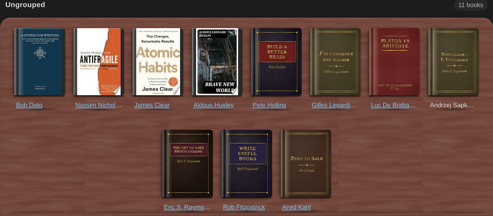
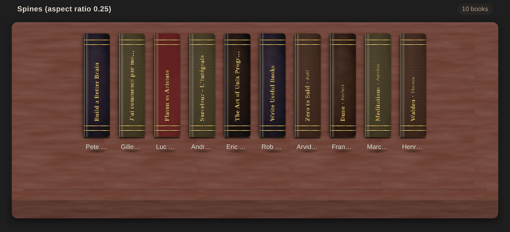

# Usage

## Requirements

- Obsidian **1.4.0** or newer.
- The **Bases** core feature enabled.

## Installation

### Community plugins (recommended)

1. In Obsidian, go to **Settings → Community plugins**.
2. Disable **Restricted mode** if it's enabled.
3. Select **Browse**, search for **Bookshelf**, install it, then enable it.

You can also browse the catalog on the [Obsidian Community](https://community.obsidian.md/) website.

### Manual installation

If the plugin isn't listed in the community catalog yet (or you want a specific version):

1. Download `main.js`, `manifest.json`, and `styles.css` from the [latest release](https://github.com/dsebastien/obsidian-bookshelf/releases).
2. Copy them into `<Vault>/.obsidian/plugins/bookshelf-base/`.
3. Reload Obsidian and enable **Bookshelf** in **Settings → Community plugins**.

### BRAT (bleeding edge)

[BRAT](https://github.com/TfTHacker/obsidian42-brat) (Beta Reviewers Auto-update Tool) installs plugins straight from a GitHub repo and keeps them updated automatically. Use this if you want the latest commits — **things might break**.

1. Install **Obsidian42 - BRAT** from **Settings → Community plugins → Browse** and enable it.
2. Run **BRAT: Add a beta plugin for testing** from the command palette.
3. Paste `https://github.com/dsebastien/obsidian-bookshelf`.
4. Select the latest version and confirm.
5. Enable **Bookshelf** in **Settings → Community plugins**.

## Creating a bookshelf

1. Create or open a `.base` file.
2. Add a view.
3. Set the view type to **Bookshelf**.
4. Open the view's options and configure at least an **Image property** (see [Configuration](./configuration.md)).

## Adding books

Any note matching the Base's filters becomes a book. A typical book note looks like this:

```yaml
---
title: The Pragmatic Programmer
author: '[[David Thomas]]'
cover: https://example.com/pragmatic.jpg
rating: 5
status: read
---
```

### Cover images

The cover property may contain:

- An external URL: `https://example.com/cover.jpg`
- A `data:` URI
- A vault-relative path: `assets/covers/book.jpg` (resolved via Obsidian's resource path)

If a note has no cover, or if its image can't be loaded, the book gets a default cover (see below).

### Default covers

Not every note has a cover image. Bookshelf binds those books itself: a hardcover drawn with CSS, with the title (and the author) lettered in gold leaf. There's no image file and nothing to download.

Cloth is the default. You can switch to leather, library binding, a mix of the three, or the old colored spine in the view options (see [Default covers](./configuration.md#default-covers) in the configuration page).



The title comes from the `title` property, or from the file name when there's none. The color (and, with **Mixed**, the binding) is picked from the title. A book keeps the same look across views and reloads.

You get a default cover when:

- The cover property is missing or empty.
- It points to a vault file that doesn't exist.
- It's a URL that doesn't load: a 404, a dead host, or no network.

#### Where the author comes from

Set **Author property** in the view options to the property that holds the author. If you leave it empty, Bookshelf tries `author`, then `authors`.

- A list shows the first author followed by "et al.".
- A wikilink shows its display text: `[[People/Umberto Eco|Eco]]` shows "Eco", and `[[People/Umberto Eco]]` shows "Umberto Eco".
- A formula works too. Handy for a Base that mixes books, albums and movies (see [Tips](./tips.md#default-covers-for-albums-movies-and-games)).

With this note, the cover reads "David Thomas et al.":

```yaml
---
title: The Pragmatic Programmer
authors:
    - '[[David Thomas]]'
    - '[[Andrew Hunt]]'
---
```

Screen readers get the same information: each cover is labeled "Title by Author".

#### Spines

Set **Aspect ratio** to `0.25` (any ratio of 0.4 or less works) and the default covers turn into spines: gold bands at the top and the bottom, and the title running from bottom to top. When the title has 16 characters or fewer, the author's last name is added after it.



### Grouping books across shelves

Set `groupBy` on the Base to split books onto multiple shelves. Each group becomes a separate shelf with a header showing the group label and the number of books. Without a grouping, all books appear on a single shelf labeled "All Books".

### Displaying properties under books

Any property added to the Base view's **display order** is shown under each book. The cover property itself is skipped to avoid duplication.

Properties whose id or display name contains "rating" are styled with a dedicated rating class.

Wikilinks (`[[Note]]` or `[[Note|Display]]`) inside displayed property values are rendered as clickable internal links and routed through Obsidian's standard link handling — Ctrl/Cmd+click opens them in a new tab.

## Interactions

| Action               | Result                               |
| -------------------- | ------------------------------------ |
| Click cover          | Open the note in the current tab     |
| Ctrl/Cmd+click cover | Open the note in a new tab           |
| Right-click cover    | Context menu (open, new tab, reveal) |
| Click a wikilink     | Open the linked note                 |

## Commands

The plugin does not currently register any slash commands. All configuration happens through the Base view's options panel.
